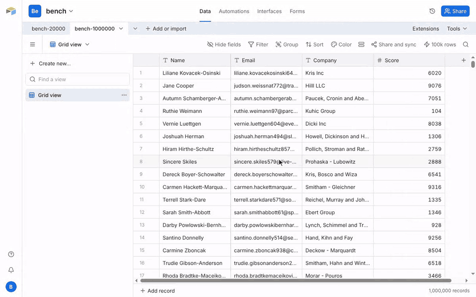
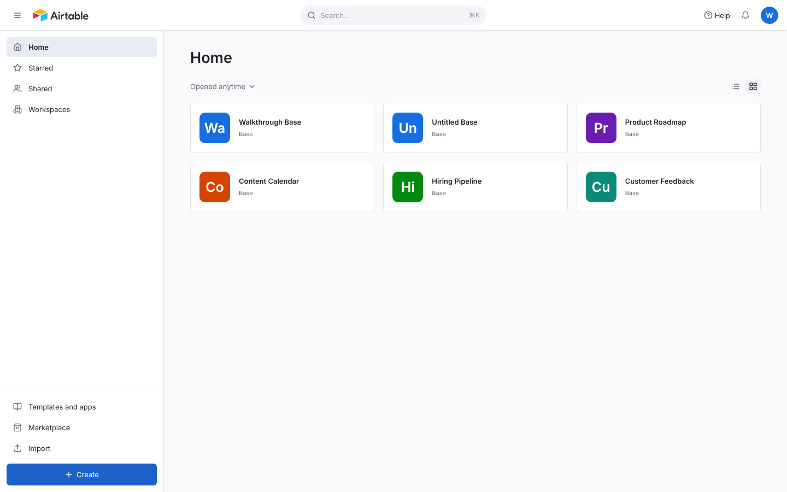
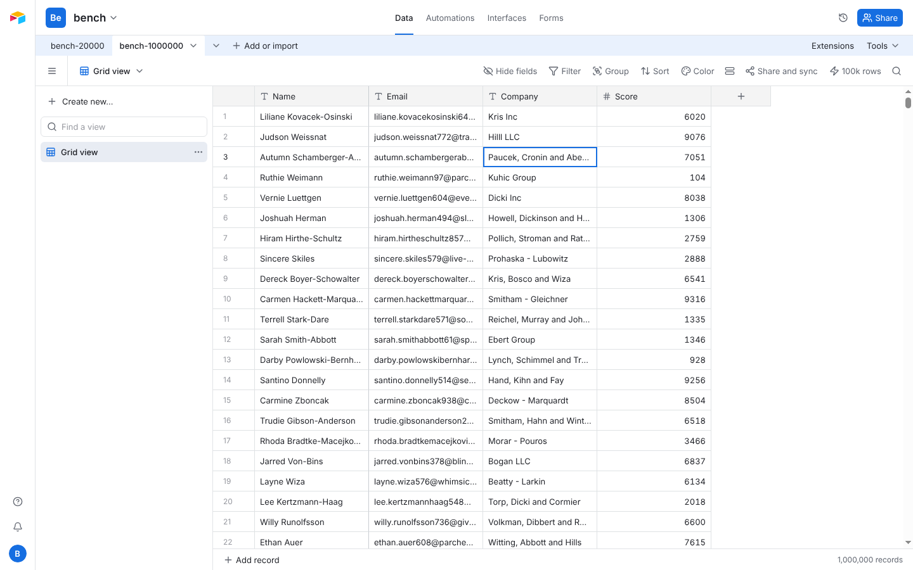
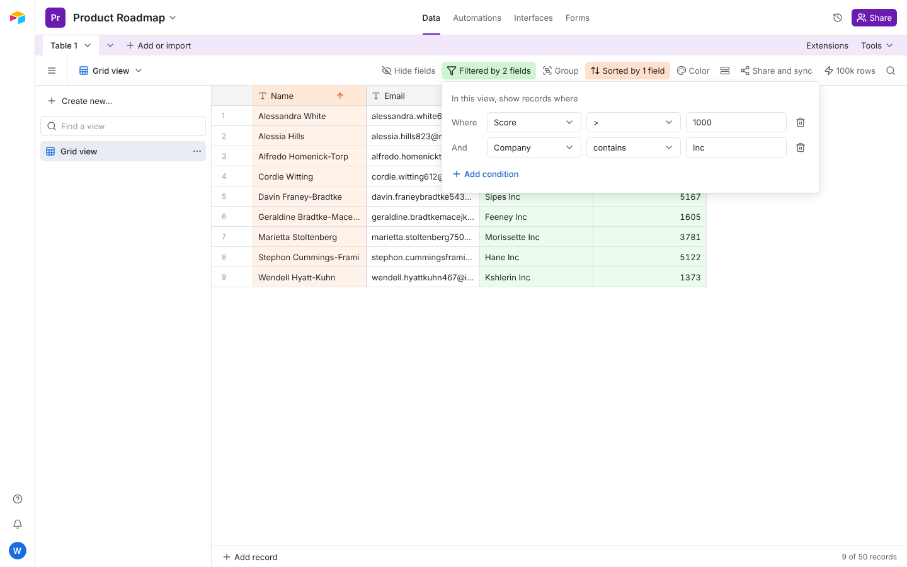
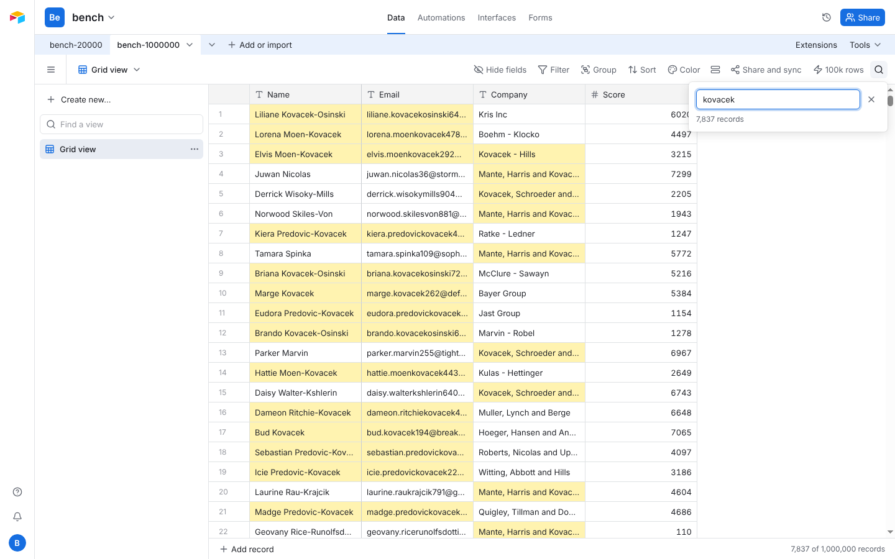
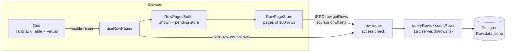
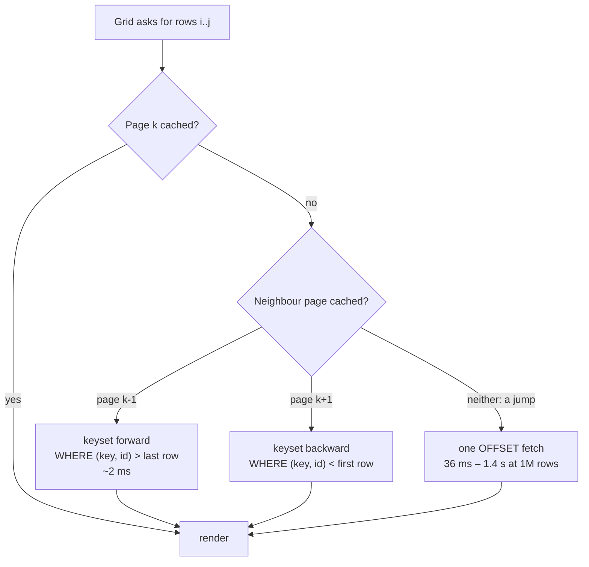
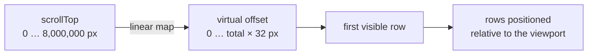

# Airtable clone

A working clone of Airtable's grid built on the T3 stack: bases, tables, views,
inline editing with the keyboard, and search, filter and sort that run in
Postgres. A table with **1,000,000 rows** scrolls without lag, and the
scrollbar can be dragged straight to the last row.

**Live demo: [airtable-clone-lyra.vercel.app](https://airtable-clone-lyra.vercel.app)**
(sign in with a Google account; each account gets its own bases).



| | |
|---|---|
|  |  |
|  |  |

It started as a two-week take-home and was then rebuilt in three planned
phases (data layer, grid, visual polish). See [How it was built](#how-it-was-built).

## What it does

| Requirement | Where |
|---|---|
| T3 stack (Next.js 15, tRPC 11, Prisma, NextAuth v5, Tailwind 4), deployed on Vercel | `src/server/api`, `scripts/vercel-build.mjs` |
| Google sign-in | `src/server/auth/config.ts`, `src/app/_components/auth/` |
| Create bases, then tables in a base | `base.create`, `table.create`; `src/app/_components/home/`, `base/TableAddPopover.tsx` |
| New tables start with default fields and 50 faker rows | `src/server/db/tables.ts` (`createTableWithDefaults`) |
| Add text and number fields | `column.create`; `grid/AddFieldPopover.tsx` |
| Edit cells; arrow keys, Tab and Enter move like a spreadsheet | `grid/useGridKeyboard.ts`, `grid/useCellEditing.ts`, `grid/gridReducer.ts` |
| A button that adds 100,000 rows | `row.addFakeRows` → `src/server/db/fakeRows.ts` (one `INSERT … SELECT generate_series` per 25k rows) |
| Virtualized infinite scroll with tRPC and TanStack Virtual | `grid/useRowPages.ts`, `grid/rowPageStore.ts`, `grid/useScaledVirtualizer.ts` |
| 1M rows load and scroll without lag | keyset paging, scaled scrolling (below); `docs/benchmarks.md` |
| Search across all cells, acting as a filter | `Row.search_text` (trigger-maintained, trigram index); `toolbar/SearchPanel.tsx` |
| Saved views with filters: number `>` `<`; text is empty, is not empty, contains, does not contain, is | `src/server/db/rows.ts` (filter SQL), `toolbar/FilterPopover.tsx` |
| Sort, hide and show fields (with a field search) | `toolbar/SortPopover.tsx`, `toolbar/HideFieldsPopover.tsx` |
| Search, filter and sort all run in the database | `src/server/db/rows.ts` (`queryRows`, `countRows`) |
| Loading states | shimmer rows, a fetch progress bar, toasts for the 100k insert |
| UI close to Airtable | Airtable's colours, spacing and type; base colours; `docs/plans/phase-3-polish.md` |

Not in the demo (they show "Not available in this demo"): other view types,
grouping, row colours, sharing, automations, interfaces and forms.

## Architecture

### Request flow



**Rows are JSONB.** Each row stores its values in one `data jsonb` column keyed
by field id, and an empty cell is a missing key. One row is one Postgres row, so
a 1M-row table is 1M rows rather than 4M cell rows, and every filter and sort is
a single expression over `data`. A trigger keeps a lower-cased `search_text`
column with a trigram GIN index, so "search all cells" is one indexed `LIKE`.

**Sorts get their own index.** Saving a sort builds a partial expression index
for that table and field (`CREATE INDEX CONCURRENTLY … WHERE "tableId" = …`),
named `rs_<table>_<field>_<a|d>`. The sort key puts empty cells last in both
directions and stays non-null, so paging is a plain row comparison. A sorted
first page takes about 2 ms instead of about 300 ms for a full sort. Table and
field ids are inlined into the SQL (after validation and an access check) so
Postgres can match those partial indexes; values are always parameters.

### The page cache



The grid's row count is the view's real total, so the scrollbar is full-size
from the first paint and rows that haven't loaded show as shimmer. Pages chain
by keyset from a cached neighbour in either direction, which costs a few
milliseconds at any depth. Only the first page after a jump (a scrollbar drag or
Ctrl+↓) pays for an `OFFSET`, and drags are debounced so they fetch where you
let go. Edits patch the cached page in place.

**Swap when ready.** A search, filter or sort change builds a second, pending
store next to the one on screen. The old rows and count stay visible until the
new count has arrived and the first screen of new rows has loaded, then both
switch in the same frame, together with the scroll-to-top. There is no frame
with shimmer rows or a stale total.

### Scaled scrolling



1,000,000 rows × 32 px is 32M px, beyond Firefox's maximum element height and at
Chrome's limit. Above 8M px the scroll spacer is capped at 8M px, and a custom
`observeElementOffset` / `scrollToFn` for TanStack Virtual maps the real scroll
position to the virtual one. Rows are positioned relative to the viewport, so
they stay pixel-exact at any depth. Below the cap, scrolling is ordinary 1:1.

## Performance

Query times on 1,000,000 rows (local Postgres 16, warm cache, page size 200;
median of 5 runs). Full results and query plans are in
[`docs/benchmarks.md`](docs/benchmarks.md).

| Query | Median |
|---|---:|
| First page, unsorted | 1.9 ms |
| Deep page by keyset (90% down) | 1.8 ms |
| Search "an", first page | 1.8 ms |
| Filter Score > 5000, first page | 1.9 ms |
| Sort Name asc, first page (sort index) | 2.1 ms |
| Sort Name asc, first page (no index) | 304 ms |
| Jump: unsorted offset 500k / 990k | 36 / 71 ms |
| Jump: filtered offset 250k | 328 ms |
| Jump: sorted offset 500k (sort index) | 1.43 s |
| Count, unfiltered / Score > 5000 | 51 / 182 ms |
| Insert 100,000 fake rows | about 8 s |

In the browser (production build, Chromium, 1440×900), a fixed 210-step wheel
scroll through the 1M-row table renders at 60 fps: across five runs
(about 2,500 frames), one frame took longer than 17 ms.

## Running locally

Requirements: Node 20+, Postgres 14+ with the `pg_trgm` extension available,
and a Google OAuth client.

```bash
npm install
cp .env.example .env    # set AUTH_SECRET (npx auth secret), AUTH_GOOGLE_ID,
                        # AUTH_GOOGLE_SECRET and DATABASE_URL
npx prisma migrate deploy
npm run dev             # http://localhost:3000
```

In the Google Cloud console, add `http://localhost:3000/api/auth/callback/google`
as an authorised redirect URI.

### Tests

The tests run against a real Postgres database (the query builder, the routers
and the access checks are integration-tested; the page cache, the scroll
scaling and the keyboard model are unit-tested). Use a separate, migrated
database:

```bash
DATABASE_URL=postgresql://…/airtable_test npx prisma migrate deploy
TEST_DATABASE_URL=postgresql://…/airtable_test npm test
```

`npm run check` runs ESLint and `tsc`, and `npm run format:check` runs Prettier.

### Benchmarks

```bash
npm run bench                    # creates a 1,000,000-row table and times the queries
npm run bench -- --reuse         # reuse the existing table
npm run bench -- --rows=100000   # a different size
```

It writes `docs/benchmarks.md`. The database is `BENCH_DATABASE_URL` (default:
a local Postgres on port 5433), and it must be migrated first.

## Project layout

```
prisma/                     schema and migrations
scripts/                    bench.ts, vercel-build.mjs (migrates on production deploys)
src/server/db/rows.ts       all row SQL: filters, search, sort keys, keyset/offset paging, sort indexes
src/server/db/fakeRows.ts   the 100k-row insert
src/server/api/             tRPC routers (base, table, column, view, row) and access checks
src/app/_components/grid/   the grid: virtualizer, page cache, keyboard, editing, header, footer
src/app/_components/toolbar/  the view toolbar, search panel and the filter / sort / hide-fields popovers
src/app/_components/        base/ (header, rail, table tabs), views/ (views sidebar), home/, auth/
src/components/             ui/ (shadcn primitives restyled to Airtable), at/ (BaseIcon, NotInDemo…)
```

## How it was built

Each phase had a written plan (the design and a list of atomic tasks) before
any code, and was reviewed and verified end to end on a 1M-row table before it
was merged:

1. [Data layer](docs/plans/phase-1-data-layer.md): JSONB rows, the query
   builder, keyset paging, sort indexes, ownership checks and the fast 100k
   insert.
2. [Grid](docs/plans/phase-2-grid.md): the full-size scrollbar with paged
   loading, scaled scrolling, keyboard navigation and editing, and column tools.
3. [Visual polish](docs/plans/phase-3-polish.md): Airtable's look on every
   page, a real full-height layout, no flash after a search, and this README.

A portfolio project, not affiliated with Airtable.
